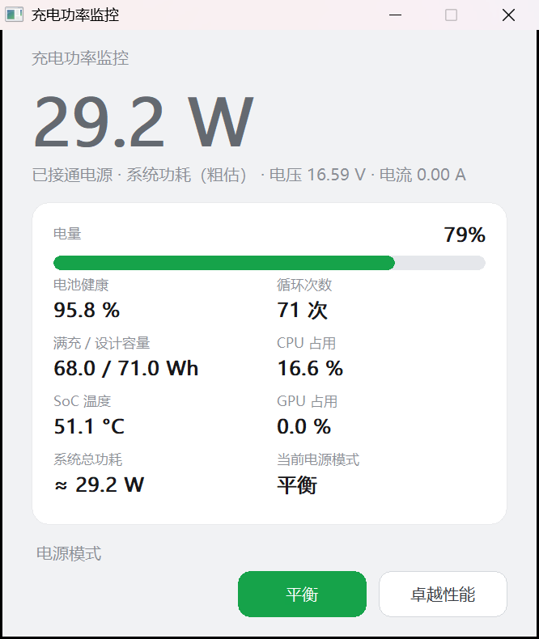
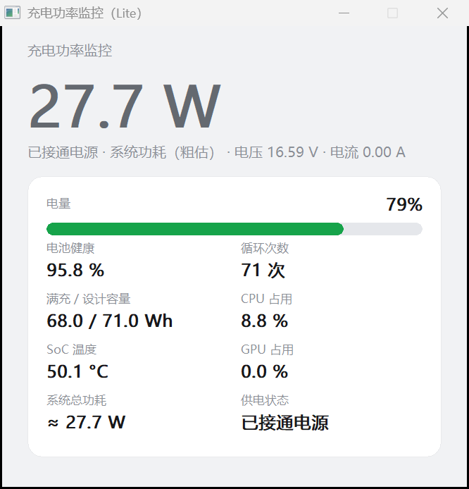

# PowerMon · 充电功率监控

Windows 桌面小工具：一块卡片看完笔记本的电池功率、电量、健康度、CPU/GPU 占用、SoC 温度与整机功耗。

纯 Win32 + GDI + WMI 单文件实现，静态链接，无第三方依赖，双击即用。**不需要管理员权限。**

| 完整版（可切换电源模式） | 精简版（只看读数） |
|---|---|
|  |  |

---

## 一、两个版本

同一个 `main.cpp`，用编译宏分出两个构建。功能差别只有一处，但边界很清楚：

| 项目 | `PowerMon.exe`（完整版） | `PowerMon-Lite.exe`（精简版） |
|---|---|---|
| 电池功率 / 电压 / 电流 / 电量 / 健康 / 循环 | ✅ | ✅ |
| CPU / GPU 占用、SoC 温度、系统总功耗 | ✅ | ✅ |
| **电源模式切换（平衡 / 卓越性能）** | ✅ | ❌ 整块代码不编译 |
| 底部方案按钮、当前方案显示 | ✅ 底部两个自绘按钮 | ❌ 换成「供电状态：已接通 / 电池供电」 |
| 加载 `powrprof.dll` | 是（`LoadLibrary` 动态取址） | 否 |
| 读注册表枚举隐藏方案 | 是（`HKLM\SYSTEM\CurrentControlSet\Control\Power\User\PowerSchemes`） | 否 |
| 写配置文件 | `%APPDATA%\PowerMon\PowerMon.ini`（记忆方案 GUID） | **不写任何文件** |
| 静态导入 | 含 `ADVAPI32.dll`、`SHLWAPI.dll` | 两者均无 |
| 体积 | 512 KB | 453 KB |

为什么单独做一个精简版：切换电源方案必须读注册表、枚举被系统隐藏的「卓越性能」方案、并写 ini 记住 GUID。对只想看读数的人来说这些都是多余的动作面。精简版把整段电源方案代码编译掉（`-DPOWERMON_LITE`），不加载 DLL、不碰注册表、不落任何文件。

两者都**不联网**、**不写日志**（仅自检模式按下述命令行运行时才会写文件）。

## 二、读数与口径

| 项目 | 数据来源 | 说明 |
|---|---|---|
| 充电 / 放电功率 | WMI `root\wmi` → `BatteryStatus.ChargeRate / DischargeRate` | mW → W，冷启动做 3 次重试并保持上次有效值 |
| 电压 / 电流 | `BatteryStatus.Voltage` | 电流 = 功率 ÷ 电压 |
| 电量 | `BatteryStatus.RemainingCapacity / FullChargedCapacity` | |
| 健康度 / 循环次数 | `BatteryStaticData.DesignedCapacity`、`BatteryCycleCount` | 每 30 秒刷新一次 |
| CPU 占用 | `GetSystemTimes` 差分 | 纯 Win32，零额外开销 |
| GPU 占用 | WMI `root\cimv2` → `GPUEngine` 计数器按 GPU 分组取最大 | 含 3D + Compute；部分时刻无实例时会显示 0.0% |
| SoC 温度 | PDH `\Thermal Zone Information(*)\High Precision Temperature` | 0.1 K → °C，取最大值 |
| 电源模式 | PowrProf `PowerEnumerate / PowerReadFriendlyName / PowerGetActiveScheme / PowerSetActiveScheme` | 仅完整版 |

### 系统总功耗（重要：区分实测与估算）

| 场景 | 算法 | 精度 |
|---|---|---|
| 电池放电中 | 放电功率 `DischargeRate` | **实测值**，无估算 |
| 充电中 | 估算系统功耗 + 充入功率 ÷ 0.90（充电损耗 10%） | 估算 |
| 已接通但无电流流动 | 估算系统功耗 | 估算，界面带 `≈` 前缀 |

估算模型在本机（Ryzen 7 8745H + Radeon 780M，ThinkBook 16 G7 AHP）上以 LibreHardwareMonitor 的 `CPU Package` 实测值标定：

```
SoC 封装功耗 ≈ 17.7 + 1.35 × √(CPU% + 0.5 × GPU%)     上限 34 W（PPT）
整机功耗     ≈ SoC 封装功耗 + 6.0 W                     主板/内存/SSD/屏/网卡/VRM 损耗
```

几个必须说明的口径：

- AMD APU 的 `CPU Package` 是**整个 SoC 封装**功耗，GPU Core / GPU SoC 已经含在里面，**不能叠加**，所以 GPU 只作为负载权重（0.5）参与，不单独加瓦数。
- 这是**经验模型，不是功率计**。换机型误差会明显变大；空载相对误差约 10% 量级。要精确值只能上 HWiNFO / LHM 这类带内核驱动的采样。
- 电池放电状态下的数字才是真值，其余都按估算看待。

## 三、使用

1. 下载 `PowerMon.exe` 或 `PowerMon-Lite.exe`，放到任意目录双击运行。
2. 完整版底部两个按钮直接切电源方案：当前激活的那个显示为绿色实心。
3. 关闭窗口即退出，无后台常驻、无服务、无开机自启。

> 「卓越性能」方案在 Windows 里默认是隐藏方案，未激活时 `PowerEnumerate` 根本枚举不到。
> 完整版的做法是：先扫注册表发现它（`PowerSchemes\<GUID>` 的 `FriendlyName` 是 `@dll,-id` 形式的 MUI 引用，用 `SHLoadIndirectString` 解析），再把 GUID 写进 `%APPDATA%\PowerMon\PowerMon.ini`，之后即使被隐藏也能直接切回去。

### 命令行自检

带参数运行会走控制台模式（方便排障与自动化）：

```bat
PowerMon.exe --console       :: 读一次全部数据，打印后退出
PowerMon.exe --switch-test   :: 依次切到 平衡 → 卓越性能，打印返回值（仅完整版）
PowerMon.exe --snapshot      :: 显示窗口 4 秒，截图存为 exe 同目录 PowerMon-snapshot.bmp
PowerMon.exe --click-test    :: 用 BM_CLICK 模拟点击两个按钮，日志写 exe 同目录 click-test.log（仅完整版）
```

`--console` 输出示例（本机实测）：

```
battery=1 online=1 powerW=0.00 chargeW=0.00 dischargeW=0.00
voltage=16.594 V current=0.000 A percent=79.0%
health=95.8% cycles=71 full=68.04Wh design=71.00Wh
cpu=8.4% gpu=0.0% socTemp=50.1 C
total=27.6W estimated=1 system=27.6W
schemeActive=平衡 balanced[1] ultimate[1]
variant=full
```

## 四、编译

需要 MinGW-w64（g++ 与 windres）。仓库自带 `build.cmd`，双击或在命令行跑：

```bat
build.cmd                        :: 使用 PATH 里的 g++
build.cmd D:\mingw64\bin\g++.exe :: 指定编译器
```

产出 `dist\PowerMon.exe` 与 `dist\PowerMon-Lite.exe`。手动编译等价命令：

```bat
windres src\app.rc -O coff -o src\app.res.o

g++ -std=c++17 -O2 -municode -mwindows -static ^
    -o dist\PowerMon.exe src\main.cpp src\app.res.o ^
    -lgdi32 -luser32 -lole32 -loleaut32 -ladvapi32 -luuid -lshell32 -lpdh -lshlwapi

g++ -std=c++17 -O2 -municode -mwindows -static -DPOWERMON_LITE ^
    -o dist\PowerMon-Lite.exe src\main.cpp src\app.res.o ^
    -lgdi32 -luser32 -lole32 -loleaut32 -luuid -lshell32 -lpdh
```

工程结构：

```
powermon/
├─ src/main.cpp        单文件源码（两种构建共用一个文件，靠 POWERMON_LITE 宏区分）
├─ src/app.ico         图标
├─ src/app.rc          图标 + 版本信息资源
├─ build.cmd           一键编译两个版本
├─ dist/               编译好的 exe
└─ docs/               开发日志、精度排查报告、界面截图
```

## 五、已知限制

1. **功耗是估算**：模型只在本机标定过（8745H / 780M）。换到别的机器，空载和负载的绝对值都会偏；放电状态下不受影响（那是实测）。
2. **方案名靠中英文关键词匹配**：`平衡` / `Balanced`、`卓越` / `Ultimate`。非中英文系统上按钮会因匹配不到而置灰（不报错、不影响读数）。
3. **GPU 占用可能显示 0.0%**：`GPUEngine` 计数器空闲时没有实例，属系统计数器行为，不是 bug。
4. **不支持风扇转速**：该机器的风扇由 EC 管理，读取需要管理员权限 + 内核驱动，代价与收益不成比例，故不做。
5. 仅支持 x64 Windows 10 1809+ / Windows 11；ARM64 与其他架构未编译、未测试。

## 六、声明

**用途**
这是一个本地只读的笔记本状态查看工具，做四件事：显示电池充放电功率与容量信息、显示 CPU/GPU 占用与 SoC 温度、按模型估算整机功耗、以及（仅完整版）切换 Windows 电源方案（平衡 / 卓越性能，等价于设置界面的电源模式下拉框）。
它**不做**：不当功率计使用（估算值不能作为功耗测试依据）、不读取或修改电池固件、不做温度控制或性能调优、不采集 GPU 的逐进程能耗、不提供任何自动优化。

**数据与隐私**
程序**不联网**，没有任何 HTTP/TCP 流量，没有遥测、没有更新检查、没有崩溃上报。
所有读数来自本机 WMI / PDH 接口，在内存里用完即弃。
写盘行为只有三处，且都可预期：
- 完整版在 `%APPDATA%\PowerMon\PowerMon.ini` 记录两个电源方案的 GUID（纯 GUID 文本，不含机器名、用户名或序列号）；
- 以 `--snapshot` 运行时，在 exe 同目录写一张 `PowerMon-snapshot.bmp` 截图；
- 以 `--click-test` 运行时，在 exe 同目录追加 `click-test.log`。
正常双击使用不会产生任何文件。

**安全**
**不需要管理员权限**，全部数据走普通用户可访问的 WMI/PDH 通道。
不安装服务、不写注册表、不注入进程、不加载驱动、不开机自启、不留后台进程。
完整版唯一的系统改动是切换电源方案——这与你在「设置 → 系统 → 电源」里手动点一下效果完全相同，并且随时可以切回来。
`powrprof.dll` 是按需动态加载并只调用其官方导出函数；精简版连这个 DLL 都不加载。

**兼容性**
Windows 10 1809 及以上、Windows 11，x64。已在 ThinkBook 16 G7 AHP（Ryzen 7 8745H + Radeon 780M / Win11 Build 26300）实机验证。
未在 Intel 平台、台式机、双电池机型、ARM64 上验证；无电池的机器会显示「未检测到电池」，不会崩溃。
方案名目前只识别中英文（`平衡`/`Balanced`、`卓越`/`Ultimate`），其他语言系统上切换按钮不可用，读数功能不受影响。

**免责**
按「现状」提供，不含任何担保。估算功耗与实际值存在偏差，请勿据此做硬件评估、电池质检或能效认证。
切换电源方案会改变系统的性能与功耗策略，如果你在跑长任务或做稳定性测试，请自行确认目标方案。
因误用、改动源码或在不兼容机型上运行造成的后果由使用者承担。

**许可**
MIT，见 [LICENSE](LICENSE)。

## 七、开发记录

| 文档 | 内容 |
|---|---|
| [docs/开发日志-C++重写.md](docs/开发日志-C++重写.md) | 从 2097 行 PowerShell 版重写为 C++ 单文件的决策过程、9 条踩坑记录、验证方式 |
| [docs/功率精度排查报告.md](docs/功率精度排查报告.md) | 用 LibreHardwareMonitor 实测标定功率模型的全过程：6 个问题、修正前后对比、真值数据 |
